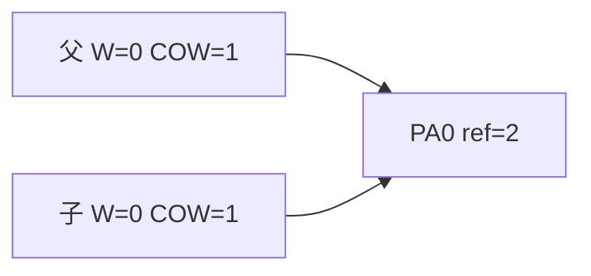
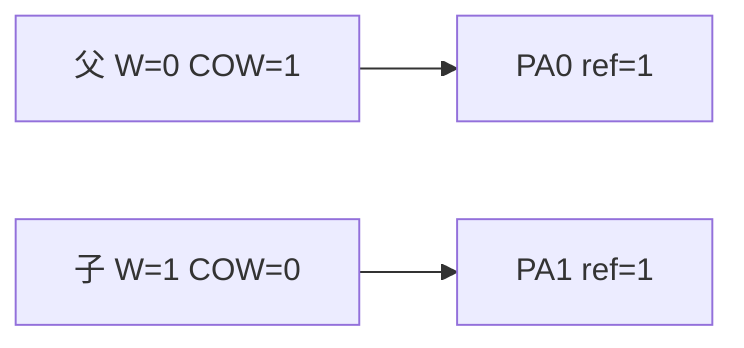
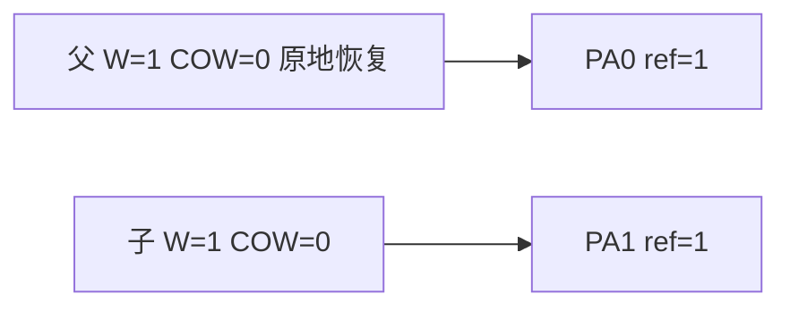

# Lab5 设计笔记

设计先于代码改动，基线为 `lab5-start`（与 `lab4-submit` 相同）。说明书 V3（2026-11-09）开头要求重构前标记基线，合并章节又建议在合并后标记；本仓库采用前者，后续合并记录进入 Git 历史，不移动基线标签。输入附件作为课程技术规范，用户当前要求决定工作范围和交付方式。

## 起点与参数

Lab4 的分配器在 vm.c 中，使用空闲位图，无引用计数；uvmcopy 全量复制用户页；trap 未处理 store page fault；copyout 仅识别 PTE_W；proc_exec 忽略 argv。迁移分配器到 kalloc.c，保留 LAB3_ALLOC_ORDER=2 的中点分配顺序和 MEMCAP_DELTA=3。

学号 2024302111427：REFCNT_SCHEME=2，KILL_SEMANTICS=1，COW_BUDGET=195。Lab1/2 参数保持原值；预置 syscall.h/user.h/usys.pl/sh.c 采用本次增量包原始字节，新增 pmc=26，其余课程预置文件不动。

## 数据结构与不变式

kmem 包含同一把自旋锁保护的空闲位图、uint16 refcnt[TOTAL_PAGES]、free_count、shared_count 和累计实际复制数。计数按 (pa-KERNBASE)/4096 索引。保留/内核静态页面不入池；专用初始入池函数将可分配页置空闲且 refcnt=0。运行期非法/重复 kfree 触发断言；只有递减至零才填充 0x5a 并回收。维护 shared_count 的 1→2、2→1 转换，使 pmc(1) 为 O(1)。kalloc 仍需按既有中点策略扫描位图。

| 场景 | 操作及代码位置 | 漏掉的后果 |
|---|---|---|
| 分配新页 | kalloc.c:kalloc，持锁置 1 | 首次释放下溢 |
| fork 共享 | vm.c:uvmcopy，成功映射后 kref_inc | 存活映射提前释放 |
| COW 分离 | vm.c:cow_alloc，新页复制及替换成功后 kfree(old) | 旧页引用泄漏 |
| 解映射/退出 | vm.c:unmap_one/freewalk → kfree | 泄漏或重复释放 |

页表页不共享；TRAMPOLINE 为内核静态页，不参加 refcnt；每进程 TRAPFRAME 在 ptable 中独占，不是用户页，不参加 COW。用户只读代码可共享，但绝不标 COW。只将原 PTE_W 页转为 PTE_COW；已经 COW 的页保持标记。父子同时只读，变更后 sfence_vma。

## 三个状态快照

仅两块物理页。后写方 ref=1，不分配第三页、不增加 pmc(0)。

## 方案比较与同步

纯 PTE 方案节省独立数组，但 RSW 只有 bit8/9，bit8 为 COW 后仅余 1 位，无法表示多进程引用；kfree(pa) 也无法定位其他私有 PTE。纯反向扫描每次释放需遍历 P 个进程和每个页表的页，约 O(P×V)；释放 N 页总体 O(N×P×V)，页数随 N 增长时接近二次工作，且无法覆盖页表页/内核分配页。wait_lock/p->lock 下再获取其他进程锁会形成锁环。因此方案 2 的运行路径仍用 64KiB 全局 refcnt，O(1) 增减与回收；不在释放路径扫描页表。

锁序为外层 wait_lock/p->lock → cow_lock → kmem.lock，kmem 不获取进程锁。cow_lock 串行化检查旧引用数、复制和递减，防止两个写方都观察 ref=2 而重复复制。现有 current_proc/调度器仅支持 -smp 1；这把锁和计数锁不构成双核支持的实测证明。

无锁反例：初始 ref=2，CPU0 和 CPU1 各读取 2、各写回 1，丢失一次减计数导致泄漏；若递增与递减交错，CPU0 读取 1准备加为2，CPU1减为0回收，CPU0再写2，存活 PTE 指向已释放并可能复用的页，引发 UAF/重复释放。

## COW、内核复制和回滚

cow_alloc 先检查 va<MAXVA、PTE_V、PTE_U、叶子权限；有 W 直接成功，无 W 无 COW 拒绝。ref=1 原地恢复 W；否则先分配、复制，再替换 PTE、记实际拷贝数、递减旧页，最后刷新 TLB。分配失败保持原 PTE/refcnt 不变。usertrap cause=15 按 KILL_SEMANTICS=1 先处理当前缺页再统一检查 killed。非法地址、只读代码和 OOM 令进程退出 -1，内核继续。

uvmcopy 跳过保护空洞。每页映射成功才增引用；失败 uvmfree 子树回收所有已增加引用和中间页。父 PTE 可保持只读 COW（语义不变，ref=1 的页下次写时原地恢复），失败路径也刷新 TLB。内核 copyout 和范围预检都在软件路径调用 cow_alloc；不得直接写共享 PA。范围整数溢出、非法高地址、只读页返回 -1。

p->cow_copies 仅记录成功的实际复制，fork 子进程从0开始，exec成功后从0开始；达到195时仅打印一次告警继续复制。pmc(0) 全局计数不因 exec 重置；pmc非法 which 返回 -1。

## exec 事务

sys_exec 从旧地址空间先提取 path、argv 指针及字符串，使用一页临时物理页作为参数缓冲；MAXARG=32（最多31个非空指针后加NULL），字符串总量受一页限制。非法/未终止/过多参数均释放临时页返回 -1。

加载新页表后在独立栈页从高到低复制参数字符串，每次16字节对齐，保存 ustack 指针；再为 argc+1 个指针减 sp 并对齐，argv[argc]=0，sp/a1指向 argv[0]。不跨栈底，不破坏保护页。所有准备成功后才提交 p->pagetable、trapframe、name及brk并释放旧地址空间；失败销毁新页表，旧程序可继续。成功 proc_exec 返回 argc，使 syscall 写入a0不会覆盖为0。初始sh以 argc=0启动。

fork立即exec的程序在旧空间通常只写一页栈，双方第一次写需至多一到两次复制；实际次数以课程 zerocopy 断言和运行日志为准。cowpair 栈与堆各一页，独占恢复保证两页合计恰好2次复制。

TRAPFRAME 如果参与COW或误清W，trampoline.S:uservec 的首个 sd ra,40(a0) 保存寄存器时就在 S 态写失败；此时尚未切换kernel satp/stvec，可能递归陷入入口并损坏现场。与普通用户COW异常无法等同处理。

## 验证计划

启动 kref_selftest：ref=1→3→2→1→0，非最后一次释放保持内容，free/shared恢复。QEMU课程 zerocopy、cowpair、echo hi；自编 cowoom 验证真实耗尽下部分fork回滚、写缺页OOM终止和内存池恢复；自编 cowtest 覆盖跨页COW、三子进程隔离、只读/guard写终止、内核copyout、exec参数失败与重试、配额告警及exec后恢复；vmtest检查fork/exec和内存回收。再运行Lab0静态资产、Lab1精确banner、Lab2四组UART、Lab3 badaccess/memcap、Lab4五项调度测试。仅实测后填写结果。

## 集成核对补充

Lab2/Lab3 的 vm.h 是课程预置接口，保持原始字节；Lab5 新声明与 RSW 定义放入自编 kernel/lab5.h。Lab5 sh.c 的新解析器仅拆空格/tab，而旧版 ulib.c:gets 保留换行。保持这两份赠送源码不动，通过仅 sh 的 -Dgets=lab5_gets 构建选项调用自编 sh_input.c，在用户态移除行尾；内核 exec 不篡改 argv 字符串，UART 字符流语义不变。
