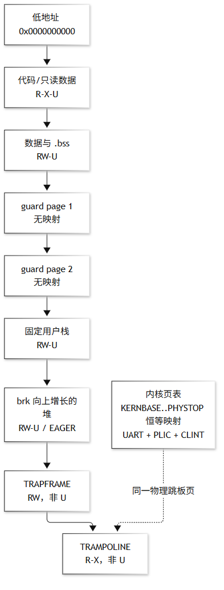
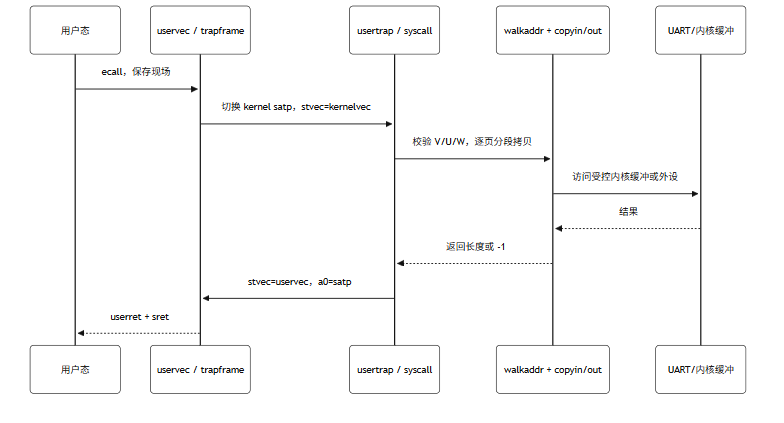
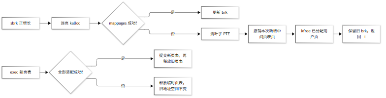
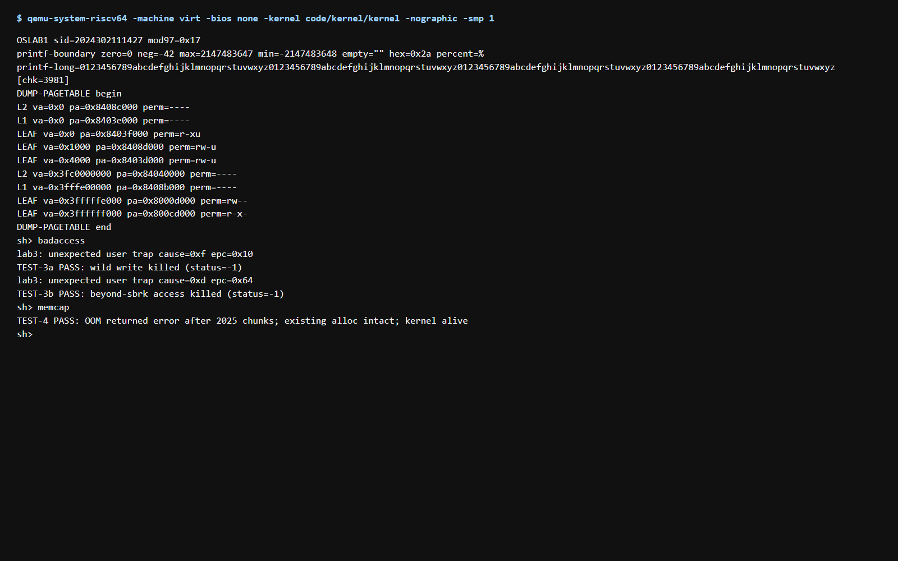

# Lab3 实验报告：物理页分配与 SV39

## 1. 目标与结果

本轮将 Lab2 的平坦用户内存改造成每进程独立的 SV39 页表。已完成物理页配额、三级页表遍历和映射回滚、内核恒等映射、用户代码/数据/保护页/栈/堆布局、`copyin/copyout`、EAGER `sbrk`、`fork` 深拷贝、`exec` 原子提交和陷阱向量切换。QEMU `virt -smp 1` 实测启动成功，`badaccess` 两条越界路径均被安全终止，`memcap` 在 2025 个 64 KiB 增长块后返回 OOM 且既有数据保持可用。

## 2. 设计笔记

### 2.1 物理页分配器与不变式

`code/kernel/vm.c` 使用位图管理 `[PGROUNDUP(kernel_end), PHYSTOP - LAB3_MEMCAP_DELTA*PGSIZE)`，每一位代表一个 4 KiB 页，`free_count` 与置位数量保持一致。`LAB3_ALLOC_ORDER=2` 按空闲页序列中点选择，分配和释放均为位图扫描；相比释放时有序插入的空闲链表，批量回收不会产生链表插入的平方级退化。分配页清零、释放页填充 `0x1`，便于发现旧内容复用。

### 2.2 页表与回滚

`walk` 按 L2→L1→L0 遍历，`mappages` 记录本次新增的中间页表页和父 PTE；建立叶子失败时清除已写入叶子、撤销父 PTE 并释放中间页。`uvmalloc` 在任一物理页或映射失败时逐页回收本次增长区间。用户页表只把用户页标记 `PTE_U`，trapframe 与 trampoline 保持内核专用映射。

PTE 的 `A/D` 位交由硬件按 RISC-V 语义置位，dump 只输出 ABI 规定的 `R/W/X/U` 四位。`usertrap` 的第一条动作切回 kernel trap vector，`usertrapret` 在调用 `userret(satp)` 前切回 trampoline 中的 uservec；`userret` 通过 `a0` 接收用户 `satp`，trapframe 始终由固定 `TRAPFRAME` 地址定位。

### 2.3 地址空间布局与权限

用户镜像构建期从 ELF 的 `__lab3_code_end` 和 `end` 符号提取只读边界及含 `.bss` 的内存边界；代码/只读数据映射 `R-X-U`，数据和 `.bss` 映射 `RW-U`。镜像之后插入 `LAB3_GUARD_PAGES=2` 个未映射保护页，再放置固定用户栈，`brk` 从栈顶向上增长。`TRAPFRAME` 和 `TRAMPOLINE` 固定在地址空间顶部；trampoline 物理页在内核页表与每个用户页表中同址映射。内核页表恒等映射至 `PHYSTOP`，并额外映射 UART、PLIC、CLINT；本实现仍使用既有 CLINT timer 寄存器路径，因此保留 CLINT 映射。

本轮不把 `KSTACK(p)` 映射进用户页表；每个 `struct proc` 的内核栈仍是内核恒等映射区中的独立数组，避免把内核栈暴露给用户，和 Lab0 快照中的高地址用户 trapframe/trampoline 区分。

图 1：用户地址空间、保护页、堆边界与内核/用户 trampoline 共享映射。



### 2.4 受控拷贝、fork 与 exec

系统调用不再直接解引用用户指针：`copyin/copyout` 逐页调用 `walkaddr`，检查 `V/U/R` 及写权限，跨页时按页边界分段。`fork` 对父地址空间逐页深拷贝，遇到 guard 空洞跳过，trapframe/trampoline 不复制；子进程重新映射自己的 trapframe。`exec` 先构建并完整填充新页表，全部成功后才替换旧页表，失败路径保留原进程地址空间。

图 2：用户态系统调用经过 trapframe、页表权限检查和跨页受控拷贝。



### 2.5 sbrk 错误路径

`SYS_sbrk` 对正增量调用 `uvmalloc`，失败时由其回滚已分配页并保持旧 `brk`；负增量调用 `uvmdealloc`。请求越过 `TRAPFRAME` 前的保护边界直接返回 `-1`。`SBRK_LAZY` 在 Lab3 按 EAGER 语义执行，后续缺页分配留给 Lab5。

图 3：`sbrk` 和 `exec` 的失败回滚/延迟提交路径。



## 3. 实测证据

真实 QEMU `virt` 单核输出截图如下；它包含启动页表 dump、`badaccess` 两条异常路径和 `memcap` OOM 回滚结果。



关键结果为：

```text
DUMP-PAGETABLE begin
LEAF va=0x0 ... perm=r-xu
LEAF va=0x1000 ... perm=rw-u
LEAF va=0x4000 ... perm=rw-u
LEAF va=0x3fffffe000 ... perm=rw--
LEAF va=0x3ffffff000 ... perm=r-x-
DUMP-PAGETABLE end
TEST-3a PASS: wild write killed (status=-1)
TEST-3b PASS: beyond-sbrk access killed (status=-1)
TEST-4 PASS: OOM returned error after 2025 chunks; existing alloc intact; kernel alive
```

`DUMP-PAGETABLE` 中 `0x1000` 为数据/`.bss`，`0x2000` 与 `0x3000` 为保护页空洞，`0x4000` 为用户栈；顶部两页分别为 trapframe 和 trampoline。代码页没有 `W`，非法写入由用户页缺页异常进入 `usertrap` 并终止子进程，父 shell 继续运行。

## 4. 查验与回归

```bash
make -C code clean && make -C code -j2
python3 -m unittest discover -s code/tests -p 'test_*.py' -v
python3 code/support/inject_uart.py --tree code --script code/support/lab3-smoke.script
rg -n '\\(char \\*\\)addr|\\(int \\*\\)addr|\\*.*user' code/kernel
```

Lab2 的 UART 输入、中断、shell、`hi` 和未知 syscall 路径沿用原有接口；Lab3 新增 `badaccess` 与 `memcap`。所有真实运行均使用 `virt`、`-smp 1`。`mappages` 的中间页表回滚、`sbrk` OOM 回滚和 exec 延迟提交是本轮重点验收点。

## 5. Git 归档

交付时检查 `lab3-start`（Lab2 基线）、`lab3` 与 `lab3-submit` 标签；最终提交同步到 `main`、GitHub 标签，并生成本地 `提交-lab3-2024302111427.zip` 和代码增量包 `lab3-code-delta-2024302111427.zip`。ZIP 不进入源码仓库。
