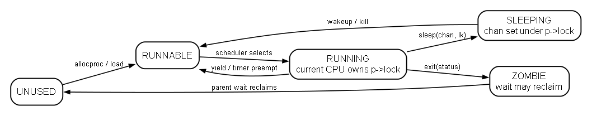
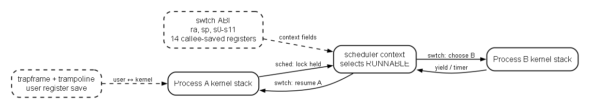
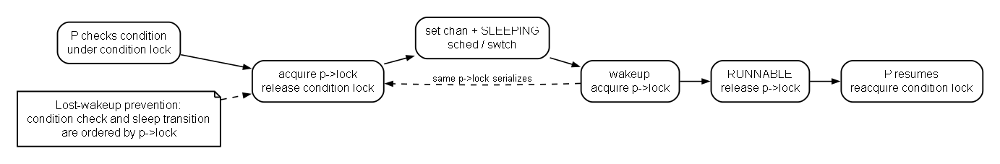

# Lab4 实验报告：进程调度、上下文切换与步长策略

> 学号：2024302111427；`LAB2_TICK=3`；`LAB4_POLICY_ID=7`；主验证环境：QEMU `virt`、`-smp 1`。
>
> 输入材料和哈希记录在 [`course-config/lab4-sources.sha256`](../../course-config/lab4-sources.sha256)。

## 1. 实验目标与完成范围

本轮把 Lab2/Lab3 的单一当前进程模型推进为可交接的内核上下文模型：`swtch` 保存和恢复 14 个 callee-saved 寄存器；每个进程持有自己的内核栈、锁、状态、通道和调度统计；`scheduler` 只选择 `RUNNABLE`；`sleep/wakeup` 通过锁序避免丢失唤醒；`pause`、`schedstat`、`time_rdtime` 和 `setickets` 提供观察入口；学号参数选择步长策略。课程没有要求 pipe，本轮不把 WFI 描述成完整调度器。

## 2. 设计笔记与不变式

设计笔记原文见 [`course-config/lab4-design-notes.md`](../../course-config/lab4-design-notes.md)。CPU 保存 `context/proc/noff/intena`；进程保存 `p->lock/context/kstack/chan/killed/cpu_ticks/last_slice_ticks/tickets/pass`；父子回收另用 `wait_lock`。`swtch` 的 0..104 偏移对应 `ra/sp/s0-s11`，用户态寄存器仍由 trapframe/trampoline 保存。

状态迁移为 `UNUSED → RUNNABLE → RUNNING`，运行中转为 `RUNNABLE`、`SLEEPING` 或 `ZOMBIE`，只有父进程 `wait` 回收后才回到 `UNUSED`。进入 `sched()` 必须持当前进程锁、关闭中断、`noff==1` 且状态不能仍是 `RUNNING`；锁跨 `swtch` 交接。固定锁序为 `wait_lock → p->lock`。`sleep(chan, lk)` 先取得 `p->lock`，再释放条件锁、设置通道和 `SLEEPING` 后 `sched`；唤醒方取得同一进程锁后才改为 `RUNNABLE`。

`LAB4_POLICY_ID=7` 使用 stride：`stride=max(1,1000/tickets)`，选择活动进程中最小 `pass`，同值轮转；新建/唤醒进程对齐当前最小 `pass`。只在用户态时钟陷入计 `cpu_ticks`、`last_slice_ticks` 并推进 `pass`。错误路径要求 fork/exec/页表构建失败释放资源；非法 pid/指针、`setickets(n<1)` 和无子进程 wait 返回错误且可重试。

## 3. 机制图



图 1：状态迁移和锁保护。



图 2：A 内核栈→scheduler context→B 内核栈；trapframe/trampoline 与 `swtch` ABI 分工不同。



图 3：先获取 `p->lock` 再释放条件锁，避免检查和入睡之间错过唤醒。

本轮没有把终端输出伪装成截图；以下逐项记录实际命令和 UART 结果，原始终端可由同样命令复现。

## 4. 实测证据

| 测试 | 命令/输入 | 真实结果 |
|---|---|---|
| 构建 | `make -C code clean && make -C code -j1` | 退出码 0；仅有链接器 `LOAD segment with RWX permissions` warning，未影响镜像生成 |
| 静态资产 | `python3 -m unittest discover -s code/tests -p "test_*.py" -v` | 18/18 通过；这是结构/接口检查，不等同于运行时证明 |
| 官方 bench | QEMU `sh>` 输入 `bench` | `RESULT avg_fork_wait = 9914`；`RESULT concurrent_children = 8`；`PASS: bench`，随后回到 `sh>` |
| 官方 stride | QEMU `sh>` 输入 `stride_test` | `RESULT stride_ratio = 75:225`；6 个 50-tick 窗口均有两个子进程运行；`PASS: stride` |
| 自编抢占 | QEMU `sh>` 输入 `alt` | 输出为 16 轮交错的 `ABAB...`，含 16 个 `A`、16 个 `B`；`PASS: alt` |
| 接口边界 | QEMU `sh>` 输入 `lab4check` | `RESULT abi_boundaries = 10`；`RESULT sleep_wait = 6 children x 6 pauses; elapsed=9080419`；`PASS: lab4check` |
| Lab2 回归 | 四个 `inject_uart.py` 脚本 | smoke、bufstorm、overflow、spin 均通过各自 `EXPECT`，并回到 shell |
| Lab3 回归 | `lab3-smoke.script` | `badaccess` 的 TEST-3a/3b 均 PASS；`memcap` 报告 OOM 回滚且内核存活 |

静态测试只证明文件、符号和接口形状；QEMU 实测才证明时钟抢占、wait/exit 回收、CPU 份额和无丢失唤醒。

## 5. 思考题记录

1. `swtch` 只保存 14 个寄存器，是因为 C ABI 将 `s0-s11`、`sp`、`ra` 定义为跨调用保持的 callee-saved 状态；caller-saved 由调用方保存，用户寄存器由 trapframe 保存。恢复 `ra` 后 `ret` 回到被切入的内核路径。
2. A→B 可能经过 `uservec → usertrap → yield/sched → swtch`，再从 scheduler context 进入 B 内核栈，最后通过 B 的 trapframe/trampoline 返回用户态。A、B 内核栈不会互相覆盖。
3. 若先释放条件锁再取得进程锁，wakeup 可能在中间看到条件已变但进程尚未标记 `SLEEPING`，导致永久睡眠；所以检查、取得 `p->lock`、设置状态和 `sched` 必须保持原子顺序。

## 6. 已知限制

本轮只在 `-smp 1` 实测，没有据此宣称双核安全。`kill` 可选，测试不应依赖它强制回收。`pause` 是基于 tick 的阻塞接口，不等同于完整通用事件调度框架；本实现也不是完整文件系统、pipe 或完整地址空间隔离实现。

## 7. Git 归档

```text
implementation commit: 13be32d（Lab4 代码、测试与验收材料）
delivery commit: 由 `lab4-submit` 标签指向的最终归档提交
lab4-start: 313879c（`lab3-submit` 的 Lab4 回归基线）
lab4: lab4-submit 所指提交
lab4-submit: 最终归档提交
origin: https://github.com/hoyuand/2024302111427.git
提交归档: `提交-lab4-2024302111427.zip`（交付时生成并校验）
代码增量包: `code/archives/lab4-code-delta-2024302111427.zip`（交付时生成并校验）
工作区: 交付前由 `git status --short --branch` 确认干净
```

归档使用最终 `lab4-submit` 标签；`main`、`lab4`、`lab4-submit` 必须指向同一提交。ZIP 生成后检查可打开、内容完整并保持不进入源码仓库。
