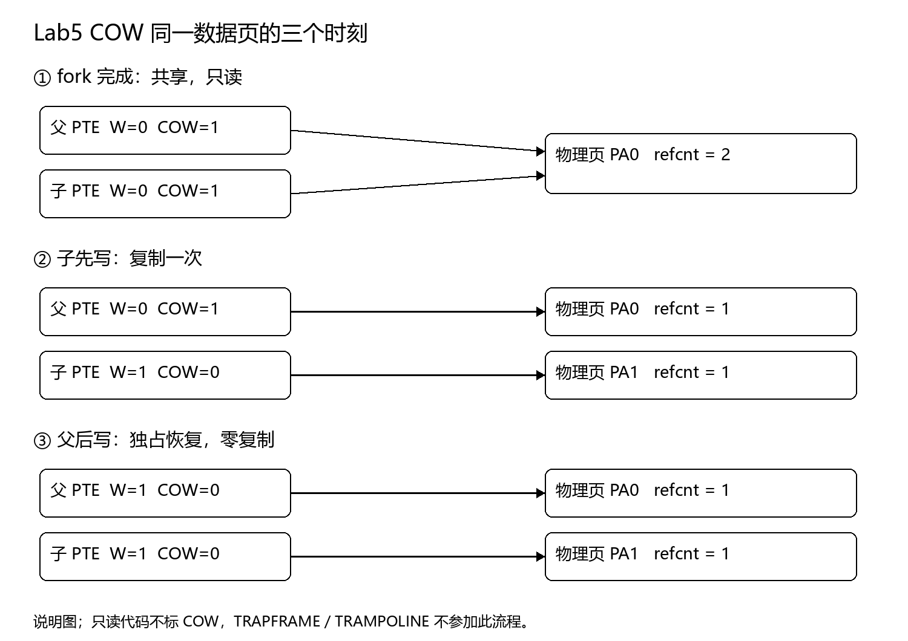
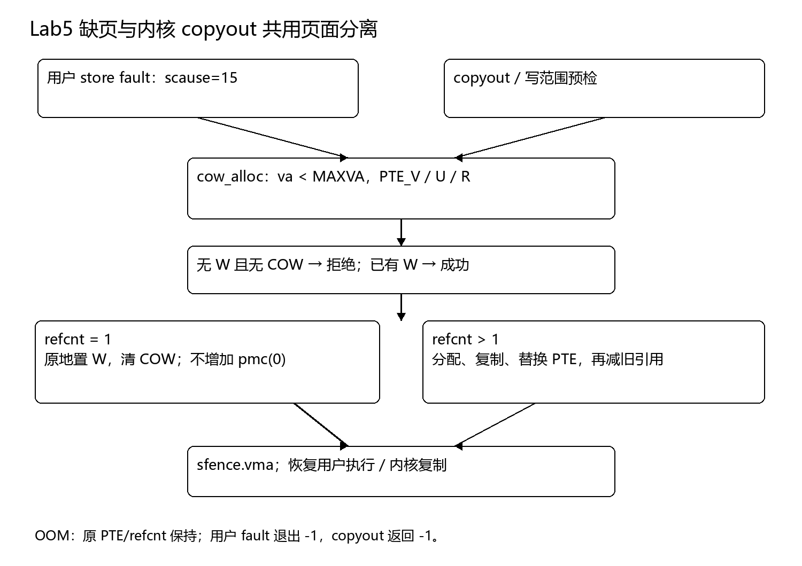
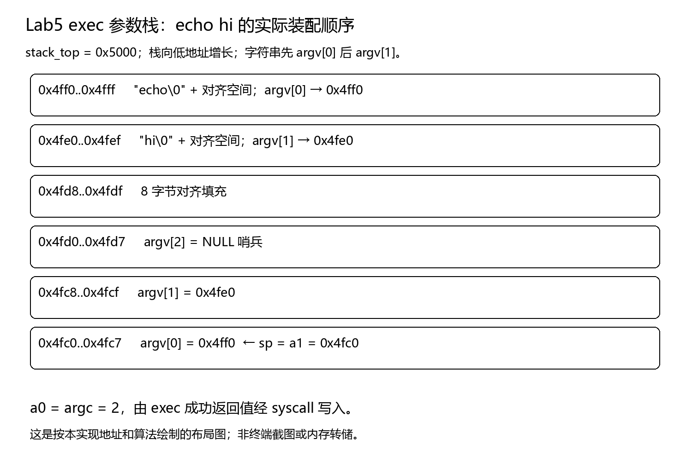

# Lab5 实验报告 写时复制 fork 与 exec 参数栈

学号：2024302111427。环境：Windows 下 WSL2 Ubuntu、QEMU virt、128MiB、`-smp 1`。本轮按 2026-11-09 V3 说明书及 v2 增量包完成，实测日期为2026-11-15。设计先于代码修改，见[设计笔记](../../../course-config/lab5-design-notes.md)；逐项映射见[要求对照](../../../course-config/lab5-v3-requirements.md)。

## 1 实验目标与完成内容

将Lab4按页全量复制的fork改为COW共享：父子可写用户页同时去掉写权限，写入时才分离；通过引用计数保证共享页最后一个引用释放后回收。同时实现pmc计数观测、内核copyout兼容COW、exec参数栈及失败回滚。程序仍来自内核内嵌表，本实验不引入磁盘文件系统。

| 文件 | 本轮变化 |
|---|---|
| code/kernel/kalloc.c | 从vm.c迁入位图分配器；增加受锁保护的引用计数、共享数、实际复制数及启动自测 |
| code/kernel/vm.c、lab5.h | COW标记、共享fork、独占恢复、范围检查、copyinstr/copyout；课程vm.h保持原样 |
| code/kernel/proc.c、proc.h | 参数栈事务装配、成功返回argc、每进程复制记账及exec重置；fork trapframe映射失败回滚 |
| code/kernel/trap.c、syscall.c | Store Page Fault分发，保持ecall后sepc+4；pmc=26和用户参数提取 |
| code/user/、Makefile | 原样合入新版预置接口、Shell及三项官方测试；自编兼容和综合测试 |
| code/tests/ | 最新预置文件/参数/文档静态检查，真实QEMU验收脚本；保留前序运行回归 |

参数由既有course_sid.h给出并脚本复算：`LAB5_REFCNT_SCHEME=2`、`LAB5_KILL_SEMANTICS=1`、`LAB5_COW_BUDGET=195`。固定Lab1/2参数全部保持。新版预置syscall.h/user.h/usys.pl/sh.c和官方三项测试逐字节核对，SHA-256记录在[合并清单](../../../course-config/lab5-course-files.sha256)；旧ulib.c、vm.h、swtch.S等继续保持原字节。

新版Shell只按空格和tab分词，旧gets保留行尾。初轮实测暴露单词命令附带换行导致exec失败，现用独立sh_input.c在用户态移除行尾，仅编译sh时映射gets调用，预置Shell和用户库原件均不修改，UART仍保持128字节字符流。

## 2 关键设计与不变式

物理页权威计数存于分配器的uint16 refcnt[32768]（64KiB），按(pa-KERNBASE)/4096索引。kmem.lock同时保护计数、空闲位图和统计；kalloc置1、成功共享映射后加1、分离或解映射减1。只有减至0时才填0x5a并归还空闲位图。启动使用专用初始入池过程，避免初始零引用下溢。共享数在1→2和2→1时更新，pmc(1)查询为O(1)；中点分配顺序保留，其查找仍扫描位图。

学号方案2要求分析反向扫描：纯扫描每次释放需遍历P个进程的页表，约O(P×V)，释放N页总体O(N×P×V)，还会遗漏页表页等非用户叶子页。退出路径持有wait_lock/p->lock时再锁其他进程容易形成锁环。因此按V3统一约定使用数组回收，不在kfree中扫描页表。PTE方案同样不能独立作为权威计数：RSW只有两位，bit8供COW使用后位宽不足，kfree(pa)也无法修改其他私有PTE。



图1表示可写数据页的三个时刻。fork后父子指向PA0且ref=2；子先写分配PA1，旧页和新页各ref=1；父后写只恢复PA0的W并清COW，既不分配第三页，也不增加pmc(0)。只读代码共享但不标COW；未映射guard跳过；TRAMPOLINE是内核静态页，TRAPFRAME是每进程独占区域，均不参与COW。

cow_alloc检查va<MAXVA、PTE_V、PTE_U、PTE_R以及W/COW组合。有W直接成功，无W且无COW拒绝；ref=1原地恢复，ref>1先分配复制、替换PTE并记账，再减少旧引用，最后sfence.vma。cow_lock串行化“检查引用数—替换—减少旧引用”，锁序为外层进程/等待锁→cow_lock→kmem.lock，分配器不反向获取进程锁。



图2说明用户store fault和软件copyout共用cow_alloc。sys_read消费UART输入前先做写范围预检，copyout也执行同样检查，避免绕过只读共享页直接写PA。未知syscall仍返回-1；syscall参数仍从a7、a0–a2获取。KILL_SEMANTICS=1使当前缺页先处理，再统一检查killed。每进程只统计成功的实际复制，达到195打印一次降级告警继续，fork子进程和exec新映像从0计数，pmc(0)全局累计不重置。

## 3 exec 用户栈与提交

sys_exec先用copyinstr读取路径，再用copyin获取旧空间argv指针；字符串存入临时分配的一页内核缓冲，避免4KiB内核栈上放大数组。最多31个参数加NULL哨兵，总字符串受一页限制。新程序与栈在独立页表准备；字符串依次向下压栈并逐次16字节对齐，最后压入argc+1个指针并再次对齐。tf->sp与tf->a1均指向argv[0]，proc_exec返回argc，经syscall写入a0。成功后才替换页表及释放旧映像。



图3按本实现echo hi的布局绘制：echo链接符号end=0x10d0，data_end=0x2000，下方两页guard，单页栈顶0x5000；依i=0..1压入后echo在0x4ff0，hi在0x4fe0，argv数组从0x4fc0开始。说明书示意图的两字符串先后与其算法文字相反，本实现依算法装配，argv内容、哨兵和对齐由官方echo实测校验。图中具体地址由链接布局和算法推导，不声称做过独立内存转储。三张图均为解释图，非终端截图；PNG展示、同名Mermaid保留流程源，渲染脚本位于code/tools/。

## 4 错误路径与回滚

| 失败位置 | 处理及保持的不变式 | 验证 |
|---|---|---|
| uvmcopy子页表中途OOM | uvmfree销毁已映射子树，逐项减引用；父页可保留ref=1的COW态，下次写原地恢复；刷新TLB | cowoom仅释放6页后fork，实测返回-1并能继续 |
| cow_alloc无法分配 | 不改变旧PTE和引用数；用户写缺页退出-1，copyout返回-1 | cowoom再次耗尽后写共享页，被终止，父数据保持 |
| 非法代码/guard写 | 没有合法COW标志则终止该用户进程，内核和Shell继续 | cowtest两次rejected store；badaccess回归 |
| exec指针非法、未终止、过多参数 | 释放临时缓冲页；旧页表不变 | cowtest分别验证path/vector/string/MAXARG边界 |
| exec新栈容不下参数 | 销毁新映像和临时页；旧映像可读写、可再次exec | cowtest 4096字节参数失败后成功执行echo recovered |
| 最后引用释放 | 仅一次毒化与回收，重复释放断言停止；计数与位图在同锁内更新 | 启动selftest及多轮共享清零、重复memcap |

## 5 实际测试与结果

以下结果来自真实QEMU运行，并非静态推测。命令从仓库根目录在WSL2执行：

```bash
make -C code clean && make -C code -j2
python3 code/check_expect.py 2024302111427 code/expect_banner.txt
python3 -m unittest discover -s code/tests -p 'test_*.py' -v
python3 code/tests/verify_lab1_qemu.py
python3 code/tests/verify_lab5_qemu.py
python3 code/tests/verify_lab5_qemu.py --tests cowoom memcap memcap
python3 code/tests/verify_lab4_qemu.py
python3 code/support/inject_uart.py --tree code --script code/support/lab2-smoke.script
python3 code/support/inject_uart.py --tree code --script code/support/lab2-bufstorm.script
python3 code/support/inject_uart.py --tree code --script code/support/lab2-overflow.script
python3 code/support/inject_uart.py --tree code --script code/support/lab2-spin.script
git diff --check
```

Makefile沿用.NOTPARALLEL，命令虽传-j2仍串行构建，构建成功，编译采用-Wall -Werror。链接存在一条既有RWX LOAD segment warning，非致命。

| 测试 | 实际结果与覆盖 |
|---|---|
| kref_selftest | refs=1,3,2,1,0；free=32525恢复，shared=0；非最后释放未毒化 |
| 官方zerocopy | T5-1 copies: 0→1，delta=1≤2；立即exec仅一页栈实际复制 |
| 官方cowpair | T5-2 copies delta=2；父子数据隔离，独占优化未多计数 |
| 官方echo hi | 输出hi；T5-3 PASS argc=2 argv[0]=echo aligned |
| echo one two three | argc=4，NULL哨兵及16字节对齐通过 |
| cowtest | 跨页COW、三子共享、wait跨页copyout、schedstat写回、代码/guard保护、7类exec失败与恢复通过 |
| 配额与重置 | 同一pid达到195打印一次告警，198页写完；exec后再次达到195仅新增一次告警；最终PASS |
| cowoom | 真实内存耗尽、部分fork失败回滚、共享页写OOM终止、父数据隔离及池回收通过 |
| vmtest | 12轮16页分配→fork→子写→wait→收缩通过，每轮shared=0 |
| Lab3 badaccess / memcap | TEST-3a/3b PASS；memcap在2023个64KiB块后返回OOM错误，两次独立调用容量相同 |
| Lab4全部五项 | lab4check、alt、bench、stride_test、policychange均PASS；bench回收8个子进程；份额75:225、改票20:60→60:20 |
| Lab1 | 294字节banner精确一致，两次冷启动一致，QEMU中断日志仅预期类型 |
| Lab2四组UART | smoke/bufstorm/overflow/spin全部EXPECT零失败，未知syscall=-1，Shell存活 |
| Lab0及资产静态检查 | 原三图、参数、文档结构等保留；静态检查21项通过，不能替代QEMU行为验证 |

UART真实节选如下（完整运行日志默认写入忽略的code/lab5-qemu.log，可用上方命令重现）：

```text
KREF-SELFTEST PASS refs=1,3,2,1,0 free=32525 shared=0
T5-1 copies: 0 -> 1 (delta 1)
T5-1 PASS: fork-immediately-exec ~zero copy
T5-2 copies delta = 2 (expect 2)
T5-2 PASS: pair-write exact 2 copies, data isolated
T5-3 PASS: argc=2 argv[0]=echo aligned
COWTEST PASS: cross-page multiway copyout readonly guard argv rollback
[cow] pid=8 reached LAB5_COW_BUDGET=195, downgrade: continue copying
COWTEST budget copies >= 198, continued
[cow] pid=8 reached LAB5_COW_BUDGET=195, downgrade: continue copying
COWTEST budget copies >= 198, continued
COWTEST PASS: exec reset and budget recovery
COWOOM partial fork rollback returned -1
COWOOM exhausted: next shared store must be killed
lab5: rejected store va=0x5000 epc=0x150
COWOOM PASS: partial fork rollback, store OOM killed, pool recovered
VMTEST PASS: 12 allocate-fork-write-wait-shrink cycles shared=0
TEST-4 PASS: OOM returned error after 2023 chunks; existing alloc intact; kernel alive
```

静态检查验证预置字节、参数公式、文档图片和引用；COW共享、隔离、精确复制计数、OOM回滚和Shell恢复来自QEMU实测。memcap容量相同及shared归零是本轮未观察到泄漏的证据，不是任意程序/任意运行时长无泄漏的数学证明。bench本轮平均fork_wait=5838（time_rdtime计数单位），不将不同环境的单次读数作为性能提升定论。

## 6 思考题与已知限制

合法COW写需可映射用户页并带COW标志；只读代码的COW位从未设置，不能借缺页获得写权限。TRAPFRAME若误设共享或只读，会在uservec保存寄存器的`sd ra,40(a0)`等指令处于S态写失败，且尚未切换kernel页表，不能当作普通用户COW处理。

两个CPU无锁读取ref=2并各写1会丢失一次减计数；递增与释放交错还可能先归零回收，再把计数写回2，造成存活PTE指向复用页。kmem.lock保护增减，cow_lock保护检查与分离。当前调度器和current_proc仍按单核实现，未验证-smp 2，不能由这两把锁推导为双核支持。KILL=0分支属于静态保留，本学号只实测KILL=1，未注入“已killed且恰逢store fault”的专用时序。

用户程序为内嵌平坦镜像，不是完整ELF文件系统；仅单页用户栈、最多31个exec参数、单页字符串临时区。Shell自身最多15个参数，无引用/管道/重定向。地址空间沿用Lab3的Sv39教学布局，guard不映射；不声称覆盖完整地址空间隔离、生产调度或完整文件系统。Lab2时期wfi等待与本轮真正的进程睡眠机制在报告中分开理解。计数使用uint16并有溢出断言，NPROC=64下正常用户共享不会达到65535。

## 7 Git 与归档

远端为 `https://github.com/hoyuand/2024302111427.git`。`lab5-start`指向重构前Lab4最终提交`be314e93beea59c320e0287182971963eee05dba`。本轮最终交付以`lab5-submit`定位；main、lab5、lab5-submit指向同一最终提交，既有Lab0–Lab4标签不移动。提交号可用下列命令核验，避免报告嵌入自身提交号的循环依赖：

```bash
git rev-parse main lab5 lab5-submit
git ls-remote --heads --tags origin
git status --short --branch
git archive --format=zip -o 提交-lab5-2024302111427.zip lab5-submit
```

完整包位于仓库根目录`提交-lab5-2024302111427.zip`；代码增量包为`code/archives/lab5-code-delta-2024302111427.zip`，包含lab4-submit至lab5-submit变动的code文件。两包均排除编译产物，并通过ZIP CRC及内容校验，不提交到Git。最终提交/远端核验结果和ZIP绝对路径在交付消息中给出。
