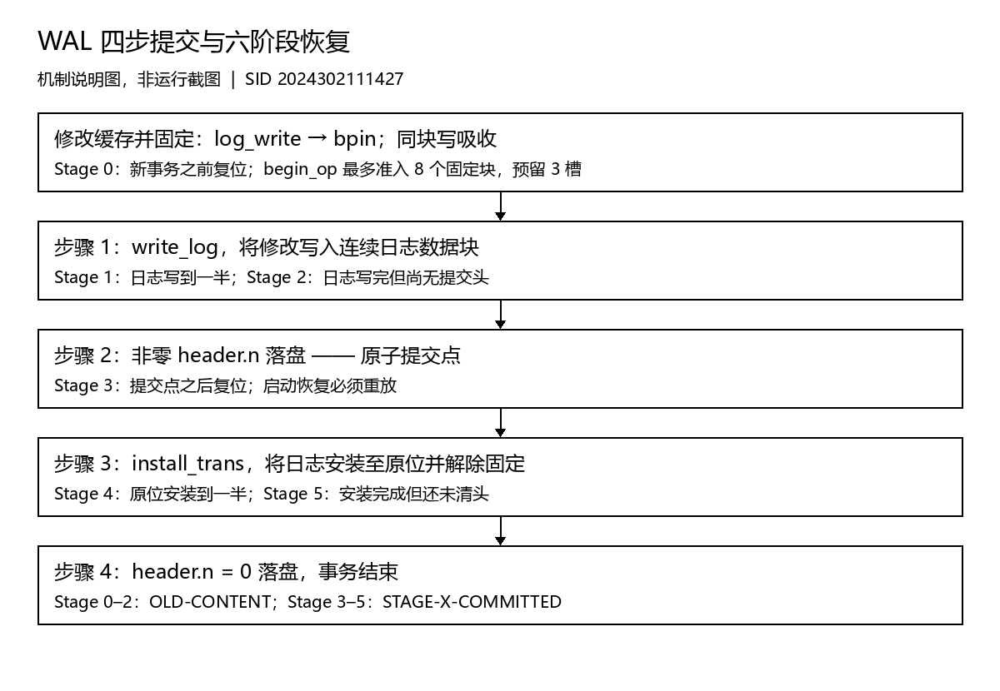
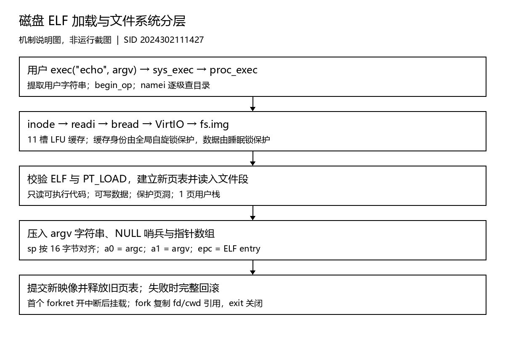

# Lab6 文件系统实验报告

学号2024302111427；实验日期2026-11-26；环境WSL2、QEMU virt、128MiB、-smp 1。依据2026-11-11 V3说明书和v2增量包，原件与课程预置接口SHA256见course-config中的Lab6清单。

## 实验目标与完成内容

在Lab5基础上接入VirtIO持久块设备，完成睡眠锁、LFU块缓存、写前日志、inode和目录、文件描述符、磁盘ELF exec与六阶段复位恢复。保留Lab1启动协议、Lab2 UART字符流与128字节缓冲、最小Sv39、Lab4调度及Lab5 COW语义。所有历史标签保留。

## 关键设计与不变式

个人参数REPLACE_POLICY=3、BUF_SLOTS=11、LOG_BLOCKS=27。缓存按freq最小淘汰，平局按stamp先装入者；引用非零不可复用。bcache自旋锁串行查重与身份分配，每块睡眠锁保护数据；磁盘等待时不持有自旋锁。脏淘汰保留旧身份和引用，写回后重新查重目标，避免竞争窗口出现同块副本。

日志LOG_PIN_CAP=8、OP_MAX_BLOCKS=8，begin_op预留至少3个缓存槽。每笔操作修改块被bpin固定，log_write同块吸收只pin一次。严格依次写日志数据、非零头、安装原位、清零头；头落盘是提交点。若提前将事务脏位图写回原位而inode未提交，断电将形成孤立块或目录引用未初始化inode；pin与准入共同防止这种破坏。

inode使用12直接块和256间接项，单文件最大274432字节。unlink仅移除目录引用；打开文件仍引用inode时继续读写，最后关闭才截断并回收间接块。fork增加file/cwd引用，exit在发布ZOMBIE前关闭。内核将fd0绑定可读CONSOLE，fd1/2绑定共享可写CONSOLE，保持前序串口语义。

首个forkret释放进程锁并开中断后fsinit；main只做无I/O的静态初始化。proc_exec通过namei/readi加载磁盘ELF，校验PT_LOAD范围、文件界限、权限和可执行入口，新页表加载后复用Lab5对齐参数栈，a0=argc、a1=argv、epc=ELF入口。栈下保留2页未映射保护洞。Makefile已移除userimg.o，运行时不再回退到内嵌程序表。

## 错误路径与回滚

ELF任一步失败释放新页表、inode和事务，旧映像保持。open文件表或fd耗尽时释放临时引用；link同名失败回退nlink；unlink拒绝点目录与非空目录。文件读写预检用户范围并兼容COW，非法指针返回-1；未知syscall返回-1，ecall跳过4字节。磁盘满返回分配失败；损坏超级块或非法日志头采用panic停止，不声称具备fsck修复能力。

## 实际测试与结果

以下是实际QEMU输出，不是从源码推测。原始UART保存在忽略的code/lab6-qemu.log与code/lab6-selftest.log，可用仓库脚本重新生成。

```text
nmeta 44 (boot, super, log blocks 28, inode blocks 13, bitmap blocks 1) blocks 1956 total 2000
BIO-SELFTEST PASS hit dirty-writeback LFU victim=1901 slots=11
LOG-SELFTEST PASS writes=5 entries=1 pin-cap=8
LAB6 disk ELF /sh loaded
T1 PASS: concurrent rw + link/unlink consistent
```

测试一：专用宏LAB6_SELFTEST启动，连续两次bread只产生一次底层读；脏块淘汰重读值保持；LFU访问序列中1900被再次命中，实际淘汰1901。日志内核自测同一块修改五次，列表只占一个项，提交后读取最终值4。自测只用于专用测试镜像；普通版不开启，不修改高端空闲块。

测试二：fstest检查创建/写入/fstat/重读、link同名回滚、open后unlink仍能读写、最后close回收；三轮16KiB文件跨直接块边界，逐字节校验并删除；嵌套目录和相对路径、非空目录与点目录拒绝、非法指针和fd耗尽回滚，并构造磁盘非法ELF，连续12次exec拒绝后仍能正常unlink和open。课程fsstress三子进程并发读写及link/unlink通过。

测试三：每个Stage执行课程crashtest，自动复位并由cat读取持久结果。[完整预测实测表](../crashmap.md)：Stage0/1/2为OLD-CONTENT；Stage3/4/5为对应STAGE-X-COMMITTED，后三阶段启动header.n非零并重放。随后额外复位且不修改文件，内容保持、头为0。测试器在临时磁盘副本执行，保留原始工作镜像。

## Lab0至Lab5回归

24项unittest静态检查全部通过：包括Lab0机制图及目录规范、原始预置文件SHA256、固定参数与文档引用。静态检查只证明这些资产与契约，不代替以下真实运行。

普通版干净构建成功；Lab1两次冷启动294字节banner逐字节一致，QEMU中断日志仅含已知陷阱。Lab2 smoke、bufstorm、overflow、spin四脚本均为EXPECT失败0条；Lab3 smoke通过TEST-3a/3b和OOM。Lab4五项lab4check/alt/bench/stride_test/policychange均PASS，本轮abi_boundaries=10、concurrent_children=8、stride_ratio=75:225，策略切换20:60变60:20；avg_fork_wait=10514为本次rdtime测量值，时间量不要求跨次固定。

Lab5九项全过：zerocopy delta=1、cowpair delta=2、echo argc=2/4对齐、cowtest非法代码/保护页及exec重置预算、cowoom部分fork回滚和真实物理耗尽、vmtest十二轮共享归零、badaccess与memcap。memcap在2023个64KiB块后正常返回错误，既有数据完整、内核继续运行。Lab5预算195告警是预期容错降级，进程继续复制，并非验收失败。

## 图片说明



上图标出原子提交点以及Stage0–5位置。事务提交前不能原位写回，提交点后启动恢复必须重放。



上图是实际实现的分层加载机制，非运行截图；两图保留同名.mmd，渲染脚本为code/tools/render_lab6_diagrams.py。

## 已知限制与非致命警告

仅验证单核QEMU，未宣称支持SMP。课程文件系统为固定2000块、一级间接块和14字节名字；无管道、设备热插拔、双重间接块、fsck或生产级磁盘故障处理。WAL依赖课程QEMU块写完成顺序与热复位模型，不能等同真实硬件掉电及扇区撕裂测试。一次begin_op通常串行准入，正确性优先于吞吐。ELF映像上限16MiB，单用户栈页、最多31个参数，沿用最小Sv39而非完整隔离系统。LFU计数没有长期老化，极长运行可能受历史热度影响。

Git在跨Windows/WSL检查时可能提示历史文件CRLF将按LF识别；这属于行尾转换提示，既有课程接口提交内容未改变。

编译启用-Wall -Werror；内核链接仍有既有的RWX LOAD segment警告，用户ELF代码与数据分别RX/RW。LAB6_SELFTEST使用高端空闲块，只在新建测试镜像开启，不能在需保留数据的磁盘上运行该宏版本。

## Git归档信息

远端https://github.com/hoyuand/2024302111427.git；lab6-start固定Lab5提交2b788cd。最终交付main、lab6、lab6-submit统一到实验提交；提交号用git rev-parse lab6-submit查验，历史标签不移动。

```bash
git status --short --branch
git rev-parse main lab6 lab6-submit
git ls-remote --heads --tags origin
git archive --format=zip -o 提交-lab6-2024302111427.zip lab6-submit
```

完整包为仓库根的提交-lab6-2024302111427.zip；相对lab5-submit的代码增量为code/archives/lab6-code-delta-2024302111427.zip。ZIP不提交Git，生成后检查CRC和提交文件内容。中文主报告仅此一篇；设计、要求对照和课程指定crashmap分别存放在其约定位置。
